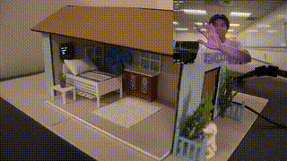

# STM32 Gesture-Controlled Smart Home

A computer-vision-to-embedded control system that uses **OpenCV + MediaPipe hand tracking** on a laptop and **UART** to control an **STM32 Nucleo-F303K8** smart-home prototype with three dimmable LEDs, an OLED menu, a fan output, and a servo-driven door.



**[Watch the full hardware demo](media/smart-home-demo.mp4)**

## What the project demonstrates

- Real-time webcam hand tracking with OpenCV and MediaPipe
- Gesture-to-command mapping in Python
- Serial UART communication between a laptop and STM32
- Three independent PWM LED channels
- Fan speed control through a transistor-driven output
- Servo position control for a model smart door
- SSD1306 OLED menu feedback over I2C
- STM32 HAL timers, GPIO, UART, I2C, and PWM

## System architecture

```text
Webcam
  |
  v
Python: OpenCV + MediaPipe
  |  gesture interpretation
  |  newline-delimited commands @ 38,400 baud
  v
UART / USART2
  |
  v
STM32 Nucleo-F303K8
  |---- TIM3/TIM2 PWM ---> 3 LEDs
  |---- GPIO soft PWM ---> fan driver
  |---- TIM1 PWM -------> servo door
  `---- I2C1 -----------> SSD1306 OLED
```

## Gesture interface

### Main menu

| Gesture | Action |
|---|---|
| Swipe up | Move OLED selection up |
| Swipe down | Move OLED selection down |
| Swipe right | Select the highlighted item |

### Lights

| Gesture | Action |
|---|---|
| Left hand: 1 / 2 / 3 fingers | Select Light 1 / 2 / 3 |
| Right-hand pinch distance | Continuously adjust selected LED brightness |
| Hold 4 fingers | Return to menu |

### Fan

The Python controller uses hand gestures to lock/unlock fan adjustment, turn the fan off, and map right-hand pinch distance into the 0-999 fan-speed command range.

### Door

| Gesture | Action |
|---|---|
| 1 finger | Close door |
| 2 fingers | Open door |
| Hold 4 fingers | Return to menu |

## Repository layout

```text
.
├── README.md
├── requirements.txt
├── src/
│   ├── python/
│   │   └── gesture_control.py
│   └── stm32/
│       └── main.c
├── hardware/
│   └── wiring.md
├── docs/
│   └── uart-protocol.md
└── media/
    ├── preview.gif
    └── smart-home-demo.mp4
```

## Run the Python controller

```bash
python3 -m venv .venv
source .venv/bin/activate
pip install -r requirements.txt
python src/python/gesture_control.py
```

The script automatically searches for an STM32/ST-Link style serial device and opens it at **38,400 baud**. Camera permission is required.

## STM32 source note

`src/stm32/main.c` is the recovered **project-specific application source** from the working prototype. It shows the UART parser, OLED screen logic, PWM LED control, servo logic, fan control, and peripheral initialization used in the demo.

This portfolio repository does **not** duplicate the full STM32CubeIDE-generated project or the third-party SSD1306 driver files (`ssd1306.*`, `fonts.*`). To rebuild from this source, create the matching STM32Cube project/configuration and provide those OLED driver files.

## Hardware mapping

See [`hardware/wiring.md`](hardware/wiring.md) for the recovered pin map. The three light outputs are PB4/TIM3_CH1, PB5/TIM3_CH2, and PB3/TIM2_CH2; the servo uses PA8/TIM1_CH1; the fan driver uses PA7; and the OLED uses PB6/PB7 on I2C1.

## UART protocol

See [`docs/uart-protocol.md`](docs/uart-protocol.md) for the command table. Commands include `L1:500`, `FAN:700`, `DOOR:0`, menu navigation commands, and active-light selection.

## Limitations

- Gesture recognition depends on camera position, lighting, and clear visibility of the user's hands.
- The system currently requires a laptop running the Python/OpenCV controller and a wired UART connection to the STM32.
- Gesture behavior uses fixed thresholds and cooldown values, so some tuning may be required for different users or environments.
- Fan speed is controlled using software PWM rather than a dedicated hardware timer.
- This repository contains the recovered project-specific STM32 application source rather than the complete STM32CubeIDE project and third-party OLED driver files.

## Future improvements

- Move fan control to a hardware PWM timer for more precise and efficient speed control.
- Add smoothing and filtering to gesture measurements to reduce brief detection fluctuations.
- Add automatic calibration for gesture and pinch-distance thresholds.
- Replace the wired UART connection with Bluetooth or Wi-Fi communication.
- Add sensor feedback and automatic control modes in addition to gesture-based control.
- Package the system into a more compact standalone prototype with cleaner wiring and enclosure design.

## Engineering takeaways

This project tied together computer vision and embedded control in a single end-to-end system. The main integration challenges were making gesture input stable enough for hardware control, keeping the Python and firmware command formats synchronized, tuning real-time thresholds and cooldowns, and coordinating multiple physical outputs while maintaining OLED feedback.

The project also reinforced the importance of designing clear communication protocols between software and hardware, debugging each subsystem independently before system integration, and accounting for timing and input variability in real-time embedded systems.
